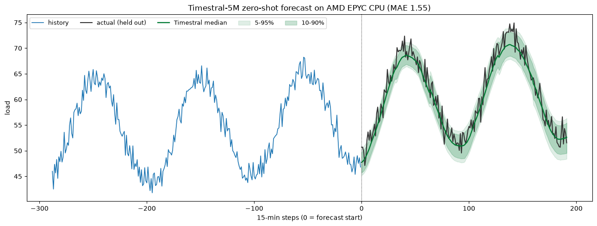

# Zero-Shot Time-Series Forecasting on AMD Hardware

Run [**Timestral**](https://huggingface.co/collections/mistralai/timestral), Mistral AI's family of time-series foundation models, on **AMD hardware** to forecast any time series **zero-shot**, with calibrated uncertainty, and **no per-dataset training**.

Give the model raw history (sales, power usage, sensor readings, demand, telemetry) and it predicts what comes next. At launch, Timestral-209M ranked **#1 among pretrained and zero-shot models** on the three main public forecasting benchmarks: GIFT-Eval, TIME, and fev-bench.

Timestral runs on **CPU or GPU**, so this tutorial covers both AMD paths:

- **AMD EPYC CPU** (no accelerator needed). A single forecast with the small model takes **under 10 ms**. Great for low-volume, latency-sensitive, or edge inference.
- **AMD Instinct MI300X GPU** (ROCm). Batches thousands of series in one pass for high-volume fleet forecasting.

Both use the same open model and the same code. You pick the hardware to match the job.



*Zero-shot forecast of a held-out 2-day window, produced on an AMD EPYC CPU with the 5M model. The median tracks the actual load and the shaded bands are the model's probability quantiles.*

## What is in this repo

| File | What it does |
|---|---|
| [`timestral_amd_cpu_tutorial.ipynb`](timestral_amd_cpu_tutorial.ipynb) | **CPU notebook.** Run Timestral on AMD EPYC, reproduce the headline CPU latency, and see the NUMA / thread tuning. Executed on a real 2-socket EPYC with outputs embedded. |
| [`timestral_amd_tutorial.ipynb`](timestral_amd_tutorial.ipynb) | **GPU notebook.** Run Timestral on AMD Instinct MI300X (ROCm), forecast with 21 quantiles, and benchmark fleet-scale throughput. Executed on a real MI300X. |
| [`CPU_BENCHMARKS.md`](CPU_BENCHMARKS.md) | Full CPU benchmark write-up, the tuning findings, and the AMD EPYC vs AMD Instinct MI300X comparison tables. |
| [`forecast_demo.py`](forecast_demo.py) | The workflow as a single runnable script (auto-selects GPU/ROCm, `DEVICE=cpu` to force CPU). |
| [`bench/`](bench/) | The CPU benchmark harness (`cpu_bench_worker.py`, `cpu_sweep.sh`) and the raw measured result JSON. |

## Sample performance: AMD EPYC CPU and AMD Instinct MI300X

Same model, same 3-week context (2016 steps), same 2-day horizon (192 steps). CPU numbers are the best single-NUMA-node configuration on a 2-socket AMD EPYC (256 cores). GPU numbers are one AMD Instinct MI300X. **All numbers measured on real AMD hardware.**

**Single-series latency (batch = 1):**

| Model | AMD EPYC CPU (best) | AMD Instinct MI300X |
|---|---|---|
| Timestral-5M | **9.3 ms** (8 threads) | 17.6 ms |
| Timestral-209M | 125 ms (16 threads) | 33.6 ms |

For a single small forecast the CPU is competitive (even faster for the 5M model), because the work is tiny and a GPU launch has fixed overhead. This is why the model ships as CPU-friendly.

**Batched throughput (batch = 256 independent series):**

| Model | AMD EPYC CPU (best) | AMD Instinct MI300X |
|---|---|---|
| Timestral-5M | 684 series/s | **10,939 series/s** |
| Timestral-209M | 24 series/s | **1,072 series/s** |

When you batch many series, the GPU's parallelism pulls far ahead (about 16x for the 5M model and 45x for the 209M model at batch 256, widening at larger batches).

See [`CPU_BENCHMARKS.md`](CPU_BENCHMARKS.md) for the full methodology, the thread/NUMA sweeps, and the model-size scaling.

## CPU tuning in one paragraph (AMD EPYC)

Three things matter on a multi-socket EPYC, in order: **(1) keep each inference on one NUMA node** (`numactl --cpunodebind=0 --membind=0`; spreading one job across both sockets is slower), **(2) cap threads at the sweet spot** (~8 for the 5M model, ~16 for the 209M model, more regresses), and **(3) to use the whole machine, run one worker per NUMA node** and split your series across them rather than one giant job.

```bash
# One well-tuned CPU worker, pinned to a single socket:
OMP_NUM_THREADS=16 OMP_PLACES=cores OMP_PROC_BIND=close \
numactl --cpunodebind=0 --membind=0 --physcpubind=0-15 \
  python forecast_demo.py
```

## Quick start

### On AMD EPYC CPU (any AMD server or workstation)

```bash
git clone https://github.com/shailensobhee/zero-shot-time-series-forecasting-AMD-tutorial.git
cd zero-shot-time-series-forecasting-AMD-tutorial

python -m venv .venv && source .venv/bin/activate
pip install torch --index-url https://download.pytorch.org/whl/cpu   # CPU PyTorch (ships oneDNN)
pip install "git+https://github.com/mistralai/timestral.git" numpy matplotlib

DEVICE=cpu python forecast_demo.py
# or open timestral_amd_cpu_tutorial.ipynb in Jupyter
```

The CPU PyTorch wheel bundles oneDNN, which already uses the EPYC AVX-512 / BF16 paths. No extra math library is needed.

### On AMD Instinct MI300X GPU (AMD Developer Cloud)

```bash
# PyTorch + ROCm is already present in the AMD Developer Cloud ROCm image
# and the rocm/pytorch Docker image, so only install Timestral + plotting libs:
pip install "git+https://github.com/mistralai/timestral.git" matplotlib pandas numpy
python forecast_demo.py                 # auto-selects the AMD GPU via ROCm
# or open timestral_amd_tutorial.ipynb
```

On ROCm, AMD GPUs are exposed through the same `torch.cuda` API:

```python
import torch
print(torch.cuda.is_available())             # True
print(torch.cuda.get_device_name(0))         # AMD Instinct MI300X
```

## Getting an AMD GPU to try this

You do not need to own a GPU. The **[AMD Developer Cloud](https://devcloud.amd.com/)** gives you on-demand access to AMD Instinct MI300X GPUs.

### Free credits via the AMD AI Developer Program

Join the **[AMD AI Developer Program](https://www.amd.com/en/developer/ai-dev-program.html)** and members receive **$100 in complimentary AMD Developer Cloud credits** (roughly **50 hours** of MI300X compute) to get started. Membership also includes a one-month DeepLearning.AI subscription, access to AMD training courses, and entry into monthly AMD hardware sweepstakes.

1. **Sign up** for the [AMD AI Developer Program](https://www.amd.com/en/developer/ai-dev-program.html). New users select "Create an account" to make an AMD account and enroll at the same time.
2. **Activate your credits.** In the [AMD AI Developer Portal](https://developer.amd.com/), open the **Member Perks** section and select **Request Cloud Credits**. Credits are deposited into your AMD Developer Cloud account (typically within a few business days) and appear on your "My AMD Home" page.
3. **Create a GPU droplet.** Sign in to the [AMD Developer Cloud](https://devcloud.amd.com/) with the same AMD credentials, open the **Create GPU Droplet** page, choose a **single MI300X** instance and a **ROCm / PyTorch** image, and add your SSH key.

> Credit terms (from AMD): complimentary credits apply to AMD Instinct MI300X usage, expire 30 days after deposit unless stated otherwise, and a powered-off instance is still billed until it is destroyed. Always destroy the instance when you are done. See the [AMD Developer Cloud page](https://www.amd.com/en/developer/resources/cloud-access/amd-developer-cloud.html) for the full terms.

## Use your own data

Replace the synthetic series with a real `(series, variates, time)` array. NaN marks missing values. Timestral also accepts past-only and known-future covariates (calendar, temperature, promotions) through `past_covariates` and `known_covariates`. See the [Timestral README](https://github.com/mistralai/timestral) for the full API.

## Model sizes

| Model | Hugging Face repo | Weights (fp32) |
|---|---|---|
| Timestral-5M | [`mistralai/Timestral-5M`](https://huggingface.co/mistralai/Timestral-5M) | 21 MB |
| Timestral-28M | [`mistralai/Timestral-28M`](https://huggingface.co/mistralai/Timestral-28M) | 111 MB |
| Timestral-123M | [`mistralai/Timestral-123M`](https://huggingface.co/mistralai/Timestral-123M) | 490 MB |
| Timestral-209M | [`mistralai/Timestral-209M`](https://huggingface.co/mistralai/Timestral-209M) | 837 MB |

The small variants give far higher CPU throughput, and all four sit on the accuracy/size Pareto front, so pick the smallest that meets your accuracy bar.

## Credits and licensing

- **Timestral** model and code are by [Mistral AI](https://mistral.ai/news/timestral). The code is Apache 2.0; the model weights are under a Modified MIT license (see each Hugging Face model card). This tutorial is not affiliated with or endorsed by Mistral AI.
- This tutorial repository shows how to run those open-source models on AMD hardware.

## Links

- Timestral blog post: https://mistral.ai/news/timestral
- Timestral code: https://github.com/mistralai/timestral
- Timestral on Hugging Face: https://huggingface.co/collections/mistralai/timestral
- AMD Developer Cloud: https://devcloud.amd.com/
- AMD AI Developer Program: https://www.amd.com/en/developer/ai-dev-program.html
- ROCm documentation: https://rocm.docs.amd.com/
