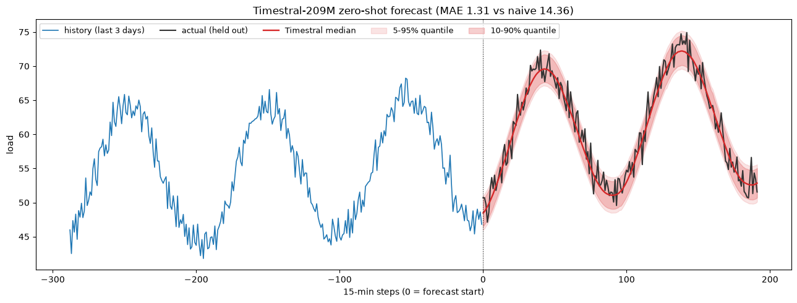

# Zero-Shot Time-Series Forecasting on AMD GPUs

Run [**Timestral**](https://huggingface.co/collections/mistralai/timestral), Mistral AI's family of time-series foundation models, on AMD Instinct GPUs to forecast any time series **zero-shot**, with calibrated uncertainty, and **no per-dataset training**.

Give the model raw history (sales, power usage, sensor readings, demand, telemetry) and it predicts what comes next. At launch, Timestral-209M ranked **#1 among pretrained and zero-shot models** on the three main public forecasting benchmarks: GIFT-Eval, TIME, and fev-bench.



*Zero-shot forecast of a held-out 2-day window. Median tracks the actual load with 90.9% skill over a naive baseline, and the shaded bands are the model's 5-95% and 10-90% probability quantiles. Produced by the notebook in this repo on a single AMD Instinct MI300X.*

## What is in this repo

| File | What it does |
|---|---|
| [`timestral_amd_tutorial.ipynb`](timestral_amd_tutorial.ipynb) | Step-by-step notebook: check the AMD GPU, load Timestral-209M, forecast with 21 quantiles, plot, and benchmark throughput. Ships with real MI300X outputs already embedded. |
| [`forecast_demo.py`](forecast_demo.py) | The same workflow as a single runnable script. |
| [`requirements.txt`](requirements.txt) | Timestral and plotting dependencies. |

## Why AMD Instinct

Timestral is plain PyTorch, so it runs on AMD Instinct GPUs through ROCm with no code changes. The payoff is **fleet-scale forecasting**: one GPU forecasts an entire fleet of series (every store, every sensor, every SKU) in a single batched pass. The 192 GB of HBM on an MI300X lets you batch a large number of series at once.

Measured on one **AMD Instinct MI300X** (gfx942), torch 2.12.0 + ROCm 7.14, with this repo's notebook:

| Batch (independent series) | Time | Throughput |
|---|---|---|
| 1 | 0.04 s | 26 series/s |
| 64 | 0.15 s | 424 series/s |
| 256 | 0.24 s | **1054 series/s** |
| 1024 | 1.22 s | 836 series/s |

Single warm forecast latency: ~36 ms. Timestral also runs CPU-only (the 5M variant forecasts in ~10 ms on CPU), which makes AMD EPYC a good fit for lightweight and edge inference.

## Getting an AMD GPU to try this

You do not need to own a GPU. The **[AMD Developer Cloud](https://devcloud.amd.com/)** gives you on-demand access to AMD Instinct MI300X GPUs.

### Free credits via the AMD AI Developer Program

Join the **[AMD AI Developer Program](https://www.amd.com/en/developer/ai-dev-program.html)** and members receive **$100 in complimentary AMD Developer Cloud credits** (roughly **50 hours** of MI300X compute) to get started. Membership also includes a one-month DeepLearning.AI subscription, access to AMD training courses, and entry into monthly AMD hardware sweepstakes.

1. **Sign up** for the [AMD AI Developer Program](https://www.amd.com/en/developer/ai-dev-program.html). New users select "Create an account" to make an AMD account and enroll at the same time.
2. **Activate your credits.** In the [AMD AI Developer Portal](https://developer.amd.com/), open the **Member Perks** section and select **Request Cloud Credits**. Credits are deposited into your AMD Developer Cloud account (typically within a few business days) and appear on your "My AMD Home" page.
3. **Create a GPU droplet.** Sign in to the [AMD Developer Cloud](https://devcloud.amd.com/) with the same AMD credentials, open the **Create GPU Droplet** page, choose a **single MI300X** instance and a **ROCm / PyTorch** image, and add your SSH key.

> Credit terms (from AMD): complimentary credits apply to AMD Instinct MI300X usage, expire 30 days after deposit unless stated otherwise, and a powered-off instance is still billed until it is destroyed. Always destroy the instance when you are done. See the [AMD Developer Cloud page](https://www.amd.com/en/developer/resources/cloud-access/amd-developer-cloud.html) for the full terms.

## Quick start

Once you have a terminal on an AMD GPU machine (AMD Developer Cloud droplet, or any host with a ROCm build of PyTorch):

```bash
git clone https://github.com/shailensobhee/zero-shot-time-series-forecasting-AMD-tutorial.git
cd zero-shot-time-series-forecasting-AMD-tutorial

# PyTorch + ROCm is already present in the AMD Developer Cloud ROCm image
# and the rocm/pytorch Docker image, so only install Timestral + plotting libs:
pip install "git+https://github.com/mistralai/timestral.git" matplotlib pandas numpy
```

### Run the script

```bash
python forecast_demo.py
# Force CPU instead:  DEVICE=cpu python forecast_demo.py
```

### Run the notebook

```bash
pip install jupyter
jupyter notebook timestral_amd_tutorial.ipynb
```

On AMD Developer Cloud you can also open the notebook directly in the browser-based Jupyter that ships with the ROCm image.

### Using the rocm/pytorch Docker image

If you prefer the container that already has PyTorch + ROCm:

```bash
docker run -it --rm \
  --device=/dev/kfd --device=/dev/dri --group-add video \
  --security-opt seccomp=unconfined \
  -v "$PWD":/work -w /work \
  rocm/pytorch:latest bash

# inside the container:
pip install "git+https://github.com/mistralai/timestral.git" matplotlib pandas
python forecast_demo.py
```

## Confirm the AMD GPU is visible to PyTorch

On ROCm, AMD GPUs are exposed through the same `torch.cuda` API:

```python
import torch
print(torch.__version__, torch.version.hip)      # e.g. 2.12.0+rocm7.14.0 7.14.60850
print(torch.cuda.is_available())                  # True
print(torch.cuda.get_device_name(0))              # AMD Instinct MI300X
```

## Use your own data

Replace the synthetic series with a real `(series, variates, time)` array. NaN marks missing values. Timestral also accepts past-only and known-future covariates (calendar, temperature, promotions) through `past_covariates` and `known_covariates`. See the [Timestral README](https://github.com/mistralai/timestral) for the full API.

## Model sizes

| Model | Hugging Face repo | Weights (fp32) |
|---|---|---|
| Timestral-5M | [`mistralai/Timestral-5M`](https://huggingface.co/mistralai/Timestral-5M) | 21 MB |
| Timestral-28M | [`mistralai/Timestral-28M`](https://huggingface.co/mistralai/Timestral-28M) | 111 MB |
| Timestral-123M | [`mistralai/Timestral-123M`](https://huggingface.co/mistralai/Timestral-123M) | 490 MB |
| Timestral-209M | [`mistralai/Timestral-209M`](https://huggingface.co/mistralai/Timestral-209M) | 837 MB |

## Credits and licensing

- **Timestral** model and code are by [Mistral AI](https://mistral.ai/news/timestral). The code is Apache 2.0; the model weights are under a Modified MIT license (see each Hugging Face model card). This tutorial is not affiliated with or endorsed by Mistral AI.
- This tutorial repository shows how to run those open-source models on AMD Instinct GPUs.

## Links

- Timestral blog post: https://mistral.ai/news/timestral
- Timestral code: https://github.com/mistralai/timestral
- Timestral on Hugging Face: https://huggingface.co/collections/mistralai/timestral
- AMD Developer Cloud: https://devcloud.amd.com/
- AMD AI Developer Program: https://www.amd.com/en/developer/ai-dev-program.html
- ROCm documentation: https://rocm.docs.amd.com/
